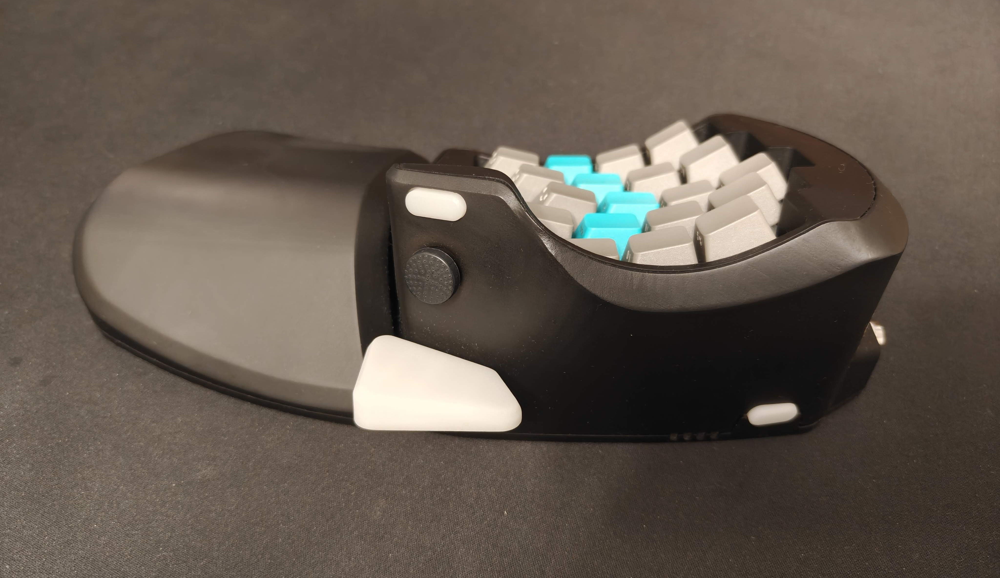
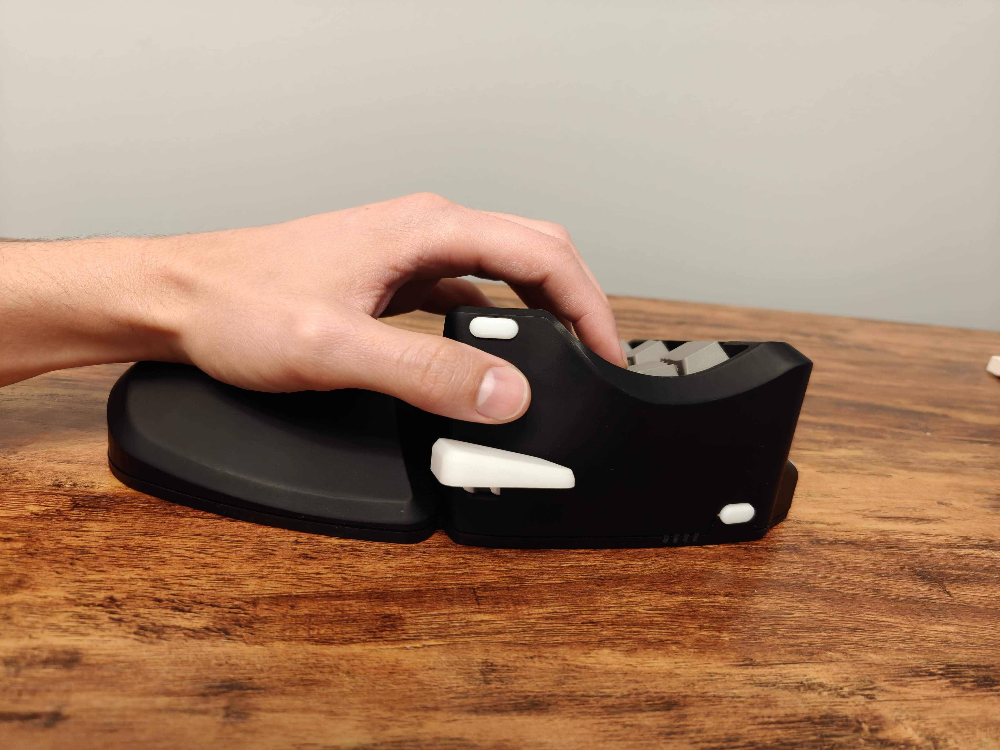
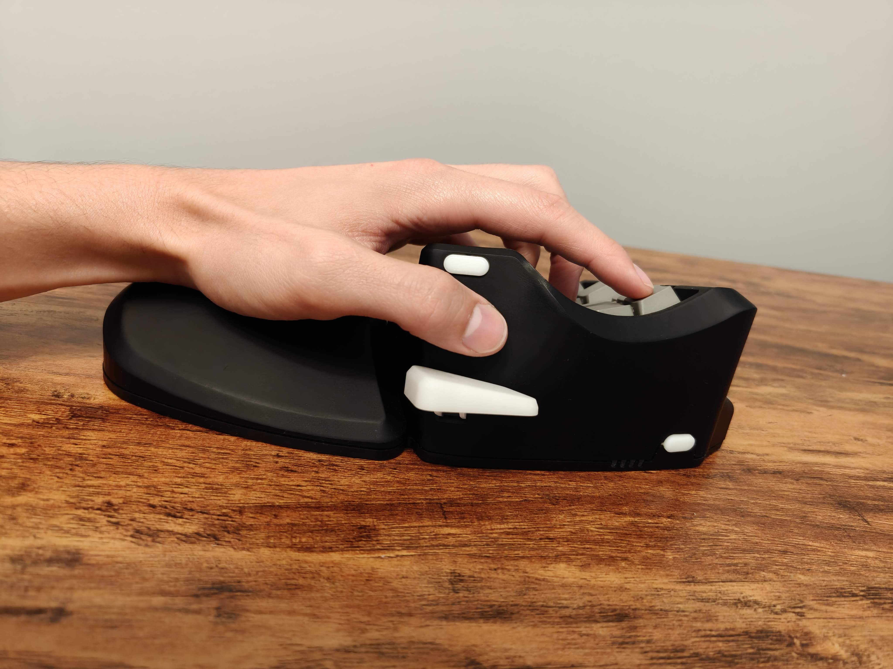
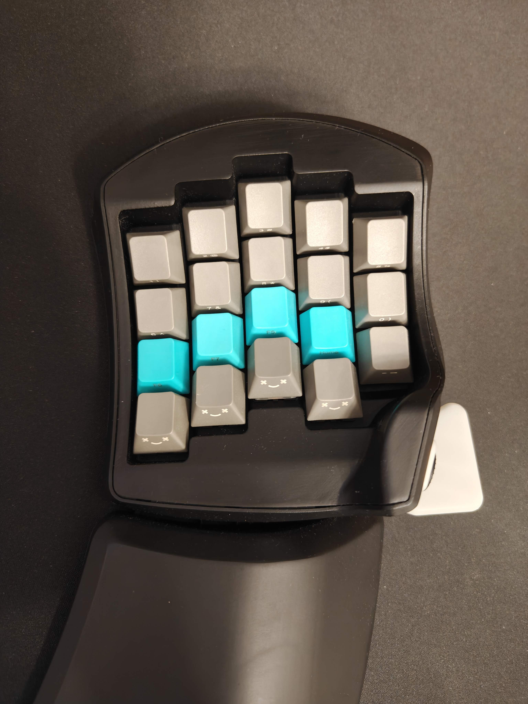
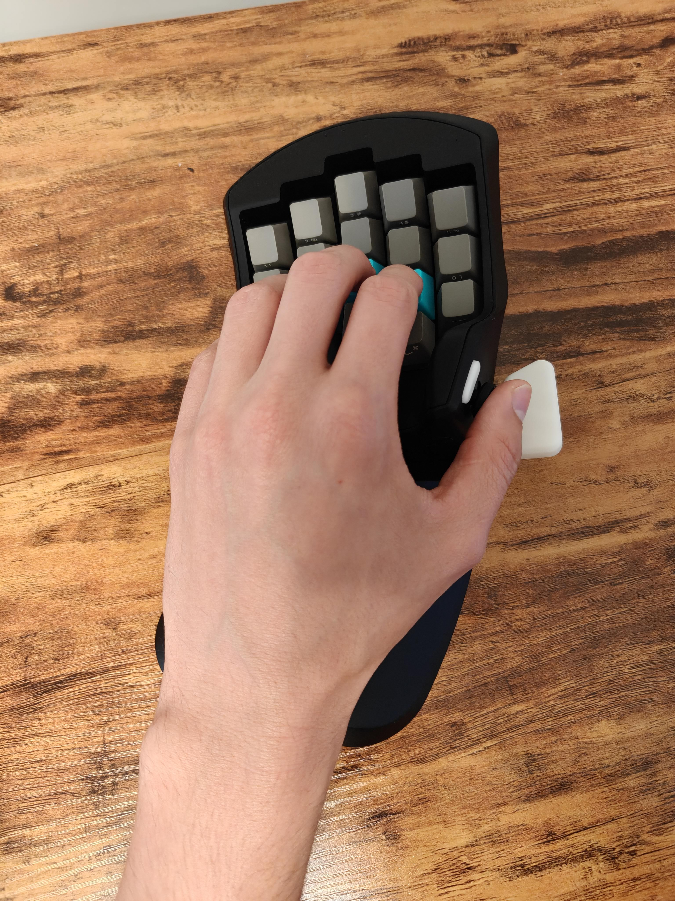
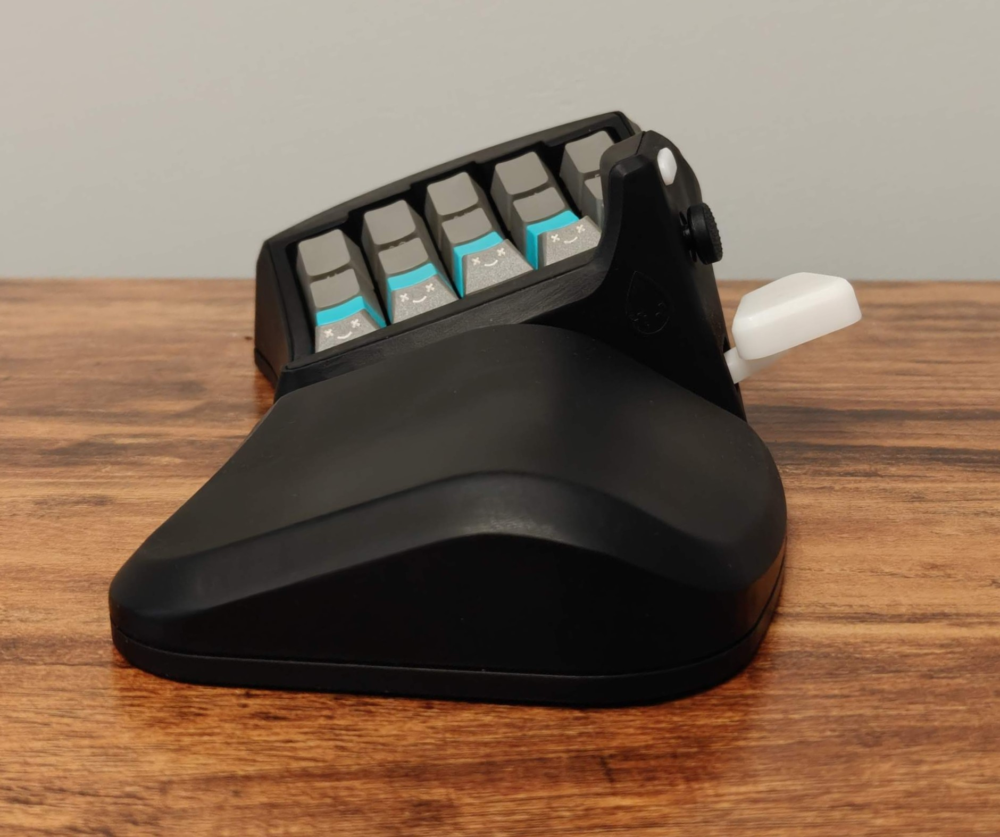
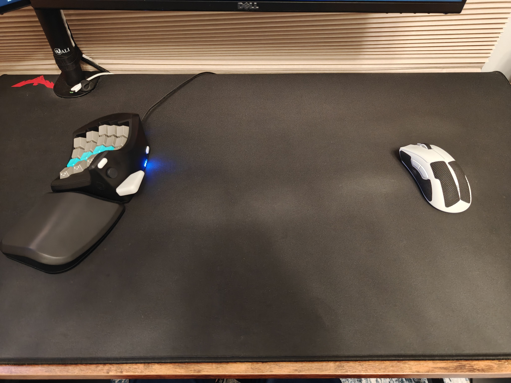
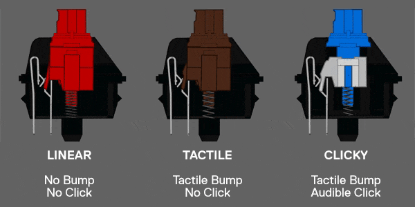
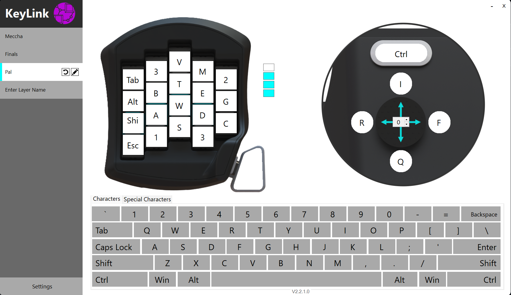

# RainDrop Ergonomic Gaming Keypad
## Your Controls, Right Where You Need Them.

**Curved Key Configuration**\
Follows the natural range of motion of your fingers to minimize stretching and keep every key within comfortable reach. 

**Finger-Aligned Key Layout**\
An intuitive linear layout with keys shifted to match the natural differences in finger length.

**Compact Thumb Cluster**\
Designed to keep thumb keys within natural reach, minimizing excessive stretching to reducing thumb strain. 

**Natural Wrist Position**\
Angled to better align with your neutral wrist position for a more comfortable gaming experience.

**More Room to Aim**\
Compact design frees up valuable mouse space, giving you greater range of motion for low-sensitivity aiming.

**Customizable Mechanical Switches**\
Choose the mechanical switches that match your preferred feel, tactile feedback, and responsiveness.

**Intuitive Configuration Software**\
Easily customize your key layout through a simple PC interface. Save up to four profiles directly to the device.

**Fully Open Source**\
Make it your own. Explore, modify, customize, and build upon the design with complete access to the source.

